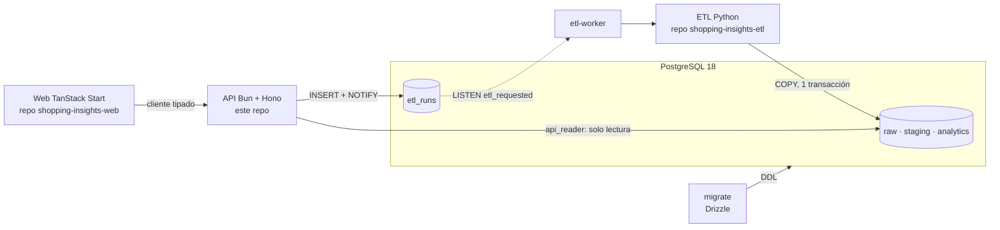

# Shopping Insights · API

API REST analítica del proyecto **Shopping Insights**, un dashboard end-to-end sobre el dataset
[Customer Shopping Trends](https://www.kaggle.com/datasets/iamsouravbanerjee/customer-shopping-trends-dataset)
para un retailer de moda. Está hecha con **Bun + Hono**, documentada con OpenAPI, y es dueña del
esquema de **PostgreSQL** (Drizzle).

El proyecto ocupa tres repositorios:

| Repo | Contenido |
|---|---|
| [`shopping-insights-etl`](https://github.com/D4v13B/shopping-insights-etl) | ETL en Python: extrae, valida, transforma y carga los datos |
| **`shopping-insights-api`** (este) | API, esquema y migraciones, roles de la base y Docker Compose del stack completo |
| [`shopping-insights-web`](https://github.com/D4v13B/shopping-insights-web) | Dashboard en TanStack Start + shadcn/ui |


## Inicio rápido: el stack completo

Requisitos: **Git** y **Docker** con Docker Compose v2.

```bash
# Los tres repos como carpetas hermanas
git clone https://github.com/D4v13B/shopping-insights-etl.git
git clone https://github.com/D4v13B/shopping-insights-api.git
git clone https://github.com/D4v13B/shopping-insights-web.git

cd shopping-insights-api
cp .env.example .env
docker compose up --build
```

| Qué | Dónde |
|---|---|
| Dashboard | <http://localhost:3000> |
| Swagger UI | <http://localhost:8080/docs> |
| Contrato OpenAPI | <http://localhost:8080/openapi.json> |
| Health check | <http://localhost:8080/health> |

El primer arranque construye las imágenes (unos 2 minutos); los siguientes tardan unos 20 segundos.
Compose construye el ETL y la web desde `../shopping-insights-etl` y `../shopping-insights-web`
(se puede cambiar con `ETL_REPO` y `WEB_REPO` en `.env`) y levanta los servicios en orden:

```
db (healthy) → migrate (termina) → etl (carga inicial, termina) → api (healthy) → web
                                                                 ↘ etl-worker (queda escuchando)
```

### Recargar los datos

Desde Swagger (`POST /api/v1/etl/run`, botón **Authorize** con la clave `ETL_API_KEY` del `.env`) o con curl:

```bash
curl -X POST -H "X-API-Key: change-me-long-random-key" http://localhost:8080/api/v1/etl/run
# → 202 {"id":"…","status":"requested"}  +  Location: /api/v1/etl/runs/{id}
curl http://localhost:8080/api/v1/etl/runs/{id}   # requested → running → success
```

Una segunda solicitud mientras hay otra activa devuelve `409`. El resultado aparece en la vista
**Calidad de datos** del dashboard.

## Arquitectura



- **Esquema**: Drizzle es el único dueño (`src/db/schema`); las migraciones están en `drizzle/`.
  `analytics` es un esquema estrella con un cubo materializado (`mv_sales_cube`) que guarda solo
  medidas aditivas.
- **Roles de mínimo privilegio** (`infra/postgres/init-roles.sh`): la API se conecta como
  `api_reader` y no puede escribir en los datos; el ETL usa `etl_writer`.
- **Validación y contrato**: `@hono/zod-openapi`. Los mismos esquemas Zod validan la entrada y
  generan `openapi.json`, que la web consume. Errores en RFC 9457 (`application/problem+json`).
- **Ruteo cubo/estrella**: si los filtros caben en el grano de `mv_sales_cube` se consulta el cubo;
  si no, la vista `v_purchases`. Un test verifica que ambas rutas dan lo mismo.

Más detalle en [`docs/architecture.md`](docs/architecture.md) y las decisiones en [`docs/adr/`](docs/adr/).

## Endpoints

Base `/api/v1`. Todos los endpoints analíticos aceptan los mismos 9 filtros opcionales (categoría,
temporada, género, edad, región, estado, suscripción, promoción y método de pago). La documentación
completa, con ejemplos, está en Swagger (`/docs`).

| Método | Ruta | Descripción |
|---|---|---|
| GET | `/health` | Estado de la API y de la base |
| GET | `/api/v1/filters/options` | Valores disponibles por filtro |
| GET | `/api/v1/kpis` | KPIs globales |
| GET | `/api/v1/sales/by-category` · `/sales/by-season` | Ventas por categoría y por temporada × categoría |
| GET | `/api/v1/products/ranking?metric=&limit=` | Top N productos |
| GET | `/api/v1/customers/segments` · `/customers/demographics` | Segmentos, edad × género y suscripción |
| GET | `/api/v1/geo/states` | Los 50 estados con su métrica |
| GET | `/api/v1/purchases?page=&pageSize=&sort=&q=` | Compras paginadas (`pageSize` ≤ 100, `sort` sobre lista blanca) |
| GET | `/api/v1/purchases/export` | CSV en streaming |
| GET | `/api/v1/etl/runs` · `/etl/runs/{id}` | Auditoría del ETL |
| POST | `/api/v1/etl/run` | Solicita una recarga. Requiere `X-API-Key`; `202`, `401` o `409` |

Ejemplo de error (`422`, `application/problem+json`):

```json
{
  "type": "urn:shopping-insights:problem:validation-error",
  "title": "Parámetros inválidos",
  "status": 422,
  "detail": "Uno o más parámetros no son válidos",
  "instance": "/api/v1/purchases",
  "requestId": "5fa86bb9-6855-4543-91f7-89cc47eb8102",
  "errors": [{ "path": "pageSize", "message": "Too big: expected number to be <=100" }]
}
```

## Desarrollo local sin Docker

Requisitos: **Bun 1.3** y un **PostgreSQL ≥ 17** (el privilegio `MAINTAIN` es de PG 17).

```bash
bun install
cp .env.example .env    # cambiar el host "db" por "localhost" en las URLs

# 1. Roles y esquema (una vez)
PGHOST=localhost POSTGRES_USER=postgres POSTGRES_DB=shopping \
  ETL_DB_PASSWORD=change-me-etl API_DB_PASSWORD=change-me-api bash infra/postgres/init-roles.sh
bun run db:migrate

# 2. Datos: ejecutar el ETL (ver el README de shopping-insights-etl)
#    cd ../shopping-insights-etl && uv sync && uv run shopping-etl run

# 3. API en http://localhost:8080
bun run dev
```

### Scripts

| Comando | Qué hace |
|---|---|
| `bun run dev` / `start` | API con recarga / en modo normal |
| `bun run lint` | Biome (lint y formato) |
| `bun run typecheck` | `tsc --noEmit` |
| `bun run test` | Tests unitarios; los de integración corren si existe `TEST_DATABASE_URL_API` |
| `bun run db:generate` | Genera una migración a partir de cambios en `src/db/schema` |
| `bun run db:migrate` | Aplica las migraciones con `DATABASE_URL_MIGRATE` |
| `bun run gen:api` | Exporta `openapi.json` sin levantar el servidor (después, en la web: `bun run sync:api`) |
| `bun run bench` | Latencias p50/p95 de los endpoints contra una API en marcha |

### Cambiar el contrato

1. Modificar las rutas o esquemas y ejecutar `bun run gen:api`.
2. Versionar `openapi.json` (el CI falla si no coincide con el código).
3. En `shopping-insights-web`, ejecutar `bun run sync:api` y versionar el resultado.

## Variables de entorno

Se validan al arrancar con Zod: si falta alguna, el proceso termina con un mensaje claro. Están
documentadas en [`.env.example`](.env.example), que sirve para el stack completo.

| Variable | Usada por | Descripción |
|---|---|---|
| `POSTGRES_*` | db | Superusuario, dueño del esquema |
| `ETL_DB_PASSWORD`, `API_DB_PASSWORD` | db | Contraseñas de los roles `etl_writer` y `api_reader` |
| `DATABASE_URL_MIGRATE` | migrate | Conexión con el dueño del esquema (DDL) |
| `DATABASE_URL_ETL` | etl, etl-worker | Conexión como `etl_writer` |
| `DATABASE_URL_API` | api | Conexión como `api_reader` |
| `KAGGLE_USERNAME`, `KAGGLE_KEY` | etl | Opcionales: sin ellas se usa el CSV de respaldo |
| `ETL_API_KEY` | api | Clave para `POST /etl/run` (mínimo 16 caracteres) |
| `INTERNAL_API_TOKEN` | api, web | Exime al SSR del rate limit (todas sus peticiones salen de una IP) |
| `WEB_ORIGIN` | api | Origen permitido por CORS |
| `API_INTERNAL_URL` | web | URL de la API desde el servidor (red de Docker) |
| `VITE_API_URL` | web (build) | URL de la API desde el navegador; se incrusta al construir |
| `LOG_LEVEL` | api, etl | Nivel de log |
| `ETL_REPO`, `WEB_REPO` | compose | Rutas de los otros repos (por defecto, carpetas hermanas) |

## Calidad y pruebas

- **bun test**: ruteo cubo/estrella, filtros parametrizados, paginación, API key y CSV; integración
  de cada endpoint (200, 401, 404, 409, 422), CORS, cabeceras y permisos de la base. 57 tests,
  97 % de líneas.
- **Rendimiento** (`bun run bench`, en Docker sobre un Mac M-series): p95 máximo de **8.7 ms** entre
  los endpoints analíticos (objetivo: < 100 ms).
- **CI** (GitHub Actions): Biome, `tsc`, contrato versionado al día, tests con un Postgres migrado y
  cargado por el ETL (hace checkout de `shopping-insights-etl`) y build de la imagen. Si los repos
  son privados, el CI necesita el secreto `CROSS_REPO_TOKEN` con lectura sobre el repo del ETL.

## Seguridad

- [x] API key comparada con `timingSafeEqual` sobre hashes SHA-256 (sin fuga por tiempo ni por longitud).
- [x] Rate limit: 100 req/min por IP y 10/min en `POST /etl/run`, con `RateLimit-*` (draft-7).
- [x] CORS limitado a `WEB_ORIGIN`; `secureHeaders` de Hono.
- [x] Todas las consultas parametrizadas (Drizzle); el orden solo acepta campos de una lista blanca; los comodines de `LIKE` se escapan.
- [x] Roles con mínimo privilegio: `api_reader` solo lee `analytics` y solo inserta en `etl_runs` (verificado con tests).
- [x] Sin stack traces en las respuestas en producción; cada error lleva su `requestId`.
- [x] El CSV exportado neutraliza fórmulas (`=`, `+`, `-`, `@`) para evitar inyección en hojas de cálculo.
- [x] Contenedores con usuario no root; secretos solo en `.env` (ignorado por git).

## Estructura

```
shopping-insights-api/
├── src/
│   ├── db/schema/      # Esquema Drizzle (raw, staging, analytics, vistas, etl_runs)
│   ├── routes/         # Rutas OpenAPI por dominio
│   ├── services/       # Consultas y exportación CSV
│   ├── lib/            # Filtros y ruteo cubo/estrella, paginación, problem+json, logger
│   └── middleware/     # API key, rate limit, log por request
├── drizzle/            # Migraciones (generadas y SQL personalizadas)
├── scripts/            # migrate, gen-openapi, bench
├── test/               # Unitarios e integración
├── infra/postgres/     # Creación de roles
├── openapi.json        # Contrato versionado
├── docs/               # Arquitectura y ADRs
├── docker-compose.yml  # Stack completo (db, migrate, etl, etl-worker, api, web)
└── Dockerfile
```

## Limitaciones y mejoras futuras

- El dataset no tiene fechas, así que no hay series de tiempo ni recencia real.
- Cola real (Redis o SQS) si hubiera varios workers; caché HTTP (ETag); autenticación OIDC con roles
  por usuario; despliegue en un servicio gestionado.
- Publicar las imágenes en un registro para que Compose no necesite los tres repos clonados.
