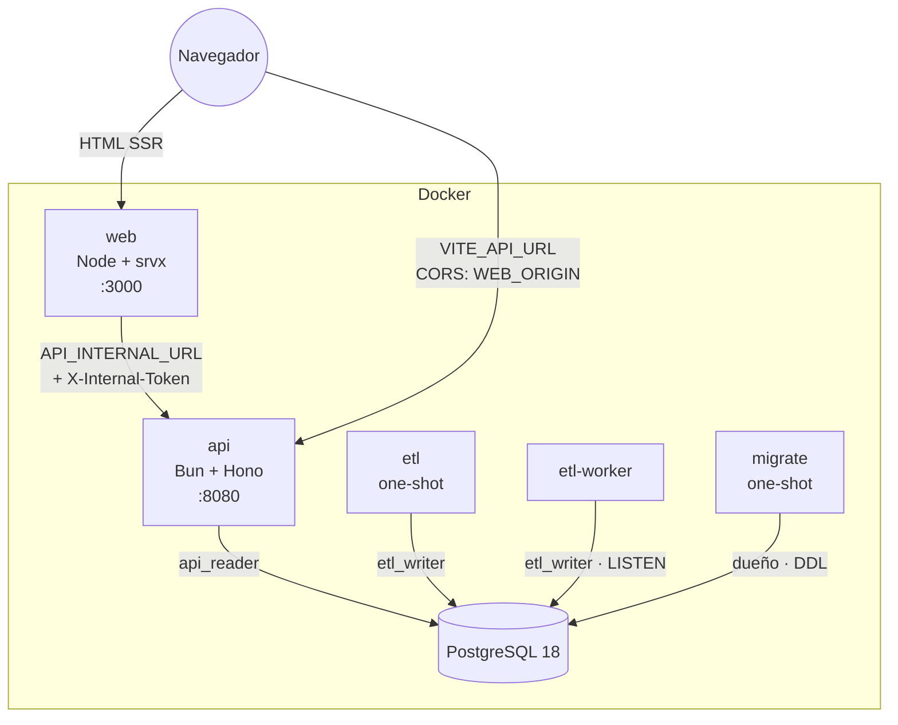
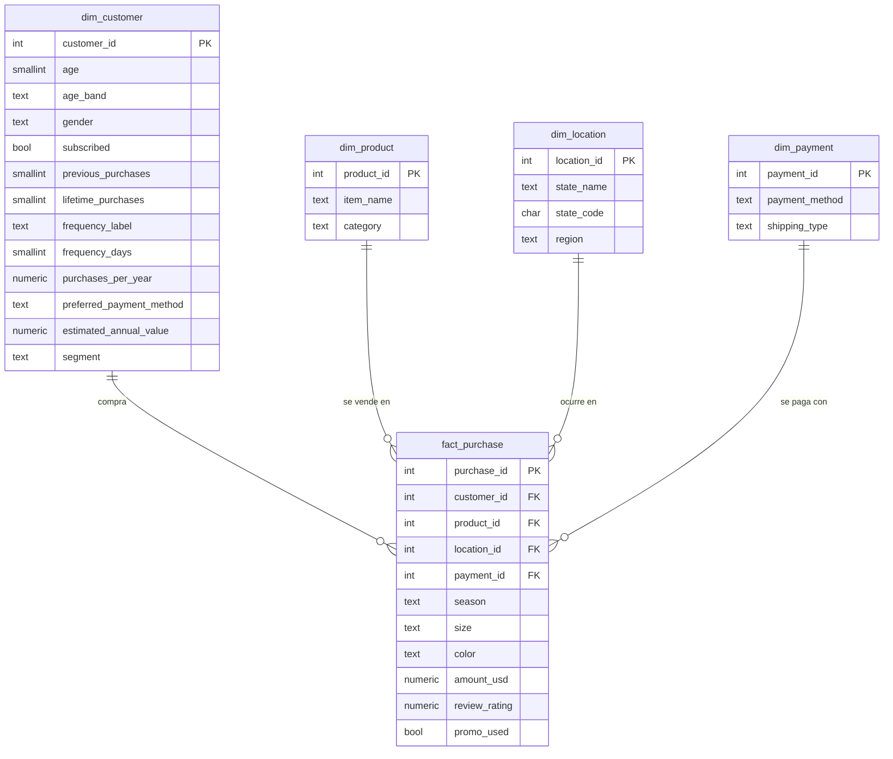

# Arquitectura

## Repositorios

| Repo | Contenido | Servicios de Compose |
|---|---|---|
| `shopping-insights-etl` | Paquete Python `shopping_etl` y CSV de respaldo | `etl`, `etl-worker` |
| `shopping-insights-api` | API, esquema Drizzle y migraciones, roles, `docker-compose.yml` | `db`, `migrate`, `api` |
| `shopping-insights-web` | Dashboard y copia versionada del contrato OpenAPI | `web` |

La separación se explica en [ADR 0016](adr/0016-tres-repositorios.md).

## Componentes

| Componente | Responsabilidad | Se comunica con |
|---|---|---|
| `db` | PostgreSQL 18: capas `raw`, `staging` y `analytics`, más `public.etl_runs` | — |
| `migrate` | Aplica las migraciones de Drizzle como dueño del esquema y termina | db |
| `etl` | Carga inicial al arrancar el stack y termina | db (`etl_writer`) |
| `etl-worker` | Queda escuchando `NOTIFY etl_requested` y ejecuta las recargas | db (`etl_writer`) |
| `api` | API REST de solo lectura más el disparo del ETL | db (`api_reader`) |
| `web` | Dashboard con SSR | api (red interna en SSR, URL pública en el navegador) |



## Modelo de datos



Las *surrogate keys* las asigna el ETL de forma determinista (ordenadas por la clave natural), así
que dos cargas del mismo archivo producen las mismas claves.

### Objetos derivados

| Objeto | Tipo | Grano / uso |
|---|---|---|
| `analytics.mv_sales_cube` | Vista materializada | (categoría, temporada, género, rango de edad, región, suscrito, promoción) con `revenue`, `orders`, `rating_sum` y `customers` |
| `analytics.mv_sales_by_state` | Vista materializada | Ventas por estado, sin filtros |
| `analytics.mv_product_ranking` | Vista materializada | Ventas por producto, sin filtros |
| `analytics.v_purchases` | Vista normal | Hechos unidos a sus dimensiones; Postgres la expande al planificar |

**Regla de ruteo** (`src/lib/filters.ts`): si todos los filtros y agrupaciones caben en el
grano del cubo, la consulta va contra `mv_sales_cube`; si incluyen `state`, `paymentMethod` o
`segment`, va contra `v_purchases`. El cubo guarda solo medidas aditivas y los promedios se calculan
al consultar (`sum(revenue) / sum(orders)`), porque un promedio de promedios es incorrecto. Un test de
integración verifica que ambas rutas dan el mismo resultado.

### Roles

| Rol | Puede | No puede |
|---|---|---|
| dueño (`postgres`) | DDL (migraciones) | — (no lo usa ningún servicio de larga vida) |
| `etl_writer` | `SELECT/INSERT/UPDATE/DELETE/TRUNCATE` en raw, staging y analytics; `MAINTAIN` (refrescar) las vistas materializadas; actualizar `etl_runs` | DDL |
| `api_reader` | `SELECT` en analytics y `etl_runs`; `INSERT` en `etl_runs` | Escribir en los datos, actualizar `etl_runs`, ver staging o raw |

## Secuencia: recarga del ETL desde la API

```mermaid
sequenceDiagram
    autonumber
    actor C as Cliente (Swagger / curl)
    participant A as API
    participant P as PostgreSQL
    participant W as etl-worker

    C->>A: POST /api/v1/etl/run (X-API-Key)
    A->>A: rate limit (10/min) + API key timing-safe
    A->>P: BEGIN; INSERT etl_runs(status='requested')
    alt ya hay una ejecución requested/running
        P-->>A: 23505 (índice único parcial)
        A-->>C: 409 problem+json
    else
        A->>P: SELECT pg_notify('etl_requested', id); COMMIT
        A-->>C: 202 {id} + Location: /api/v1/etl/runs/{id}
        P-->>W: NOTIFY (se entrega al hacer commit)
        W->>P: pg_try_advisory_lock · UPDATE → running
        W->>W: extract → validate → transform → segment → model
        W->>P: BEGIN; TRUNCATE; COPY ×8; REFRESH ×3; UPDATE → success; COMMIT
        C->>A: GET /api/v1/etl/runs/{id}
        A-->>C: {status: "success", qualityReport: …}
    end
```

**Garantías**

- **Una sola ejecución activa**: un índice único parcial
  (`ON etl_runs ((true)) WHERE status IN ('requested','running')`) lo garantiza en la base, sin
  condiciones de carrera entre dos `POST` simultáneos. Además, el ETL toma un *advisory lock* de sesión
  durante toda la ejecución.
- **NOTIFY no se encola**: si el worker no estaba escuchando, el aviso se pierde pero la fila no. El
  worker procesa las filas `requested` al arrancar, después de cada reconexión y cada 30 segundos.
- **Ejecuciones huérfanas**: si un proceso muere a mitad de camino, Postgres libera su advisory lock.
  La siguiente ejecución, ya con el lock, marca como `failed` las filas que seguían en `running`.
- **Todo o nada**: la carga y el `UPDATE … success` van en la misma transacción. Si algo falla, el
  rollback deja los datos anteriores intactos y el estado `failed` se registra por otra conexión.

## Frontend

- **Rutas**: `/`, `/productos`, `/clientes`, `/geografia`, `/compras` y `/calidad`
  (archivos en `src/routes` del repo `shopping-insights-web`).
- **Estado en la URL**: la ruta raíz valida los filtros con Zod (`validateSearch`) y `.catch()`
  descarta valores inválidos de un enlace en vez de romper la página. `/productos` añade `metric` y
  `/compras` añade `page`, `pageSize`, `sort` y `q`.
- **Datos**: cada ruta declara `loaderDeps` (sus filtros) y precarga con
  `queryClient.ensureQueryData`. En SSR la precarga ocurre en el servidor y el cliente rehidrata la
  caché de TanStack Query (`@tanstack/react-router-ssr-query`). Las query keys incluyen los filtros.
- **Cliente tipado**: `openapi-fetch` con los tipos generados desde `/openapi.json`. Si la API cambia
  su contrato y no se regeneran los tipos, falla el CI.
- **Errores**: `problem+json` se convierte en `ApiError`. Cada ruta tiene un error boundary con
  "Reintentar", y los errores de un refetch en segundo plano se avisan con un toast.

## Observabilidad

- **API**: una línea JSON por request (pino) con `request_id`, método, ruta, status y duración. El
  `X-Request-Id` vuelve en la respuesta y en cada `problem+json`.
- **ETL**: logs JSON (structlog) con `run_id` en cada línea; el conteo por tabla y la distribución de
  segmentos quedan registrados.
- **Healthchecks**: `pg_isready` por TCP (db), `GET /health` con `SELECT 1` (api) y `GET /calidad`
  (web). Compose usa estos chequeos para ordenar el arranque.
